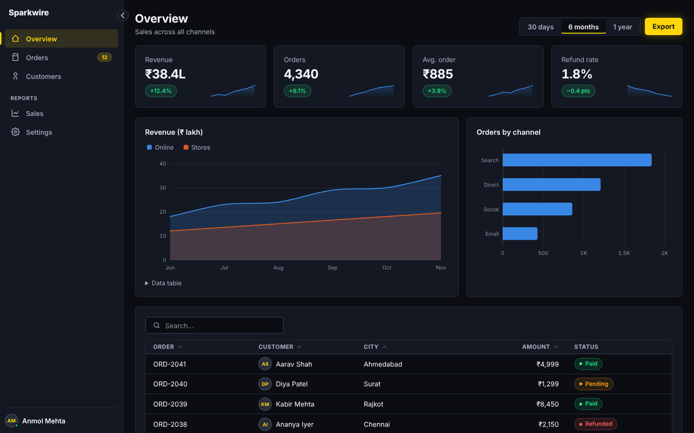

<div align="center">

# Sparkwire

**React components that carry current.**

Accessible behaviour you can trust, a look nobody else has, and code you can own.

[](https://www.npmjs.com/package/@sparkwire/core)
[](https://github.com/phoenix-am/spark-ui/actions/workflows/ci.yml)
[](LICENSE)
[](https://phoenix-am.github.io/spark-ui/)

[**Docs and live examples**](https://phoenix-am.github.io/spark-ui/) · [Get started](#get-started) · [Components](#components) · [Guide](docs/guide.md)



</div>

## Why Sparkwire

- **A look with a pulse.** Buttons throw sparks, current flows along whatever is selected, and modals arrive like a power cut. One setting turns it up for a launch page or down for an admin panel.
- **Restyle in plain CSS.** Every token is a `--spark-*` variable and every state is a `data-*` attribute. There's no CSS-in-JS runtime, so it works in Next.js Server Components, and there's a Tailwind preset.
- **Accessible by default.** The hard parts (date pickers, comboboxes, menus, tables) are built on React Aria, and every story is checked with axe in CI.
- **Built for India, and everywhere else.** All built-in text comes in English, Hindi, Gujarati and Tamil, with native digits, and dates read naturally in any locale.
- **Yours three ways.** Install the npm package, use only the headless hooks, or copy the source into your app with one command.
- **Ready for AI coding tools.** There's an MCP server, `llms.txt` and an agent skill, so assistants use real props instead of guessing.

## Get started

```bash
npm install @sparkwire/core
```

```tsx
// Import the styles once, e.g. in app/layout.tsx
import '@sparkwire/core/styles.css';

import { Button } from '@sparkwire/core/button';
import { DatePicker } from '@sparkwire/core/date-picker';

export default function Page() {
  return (
    <>
      <DatePicker label="Delivery date" presets={['today', 'tomorrow', '+7d']} />
      <Button>Place order</Button>
    </>
  );
}
```

No provider is needed. Each component has its own import path, so you only ship what you use, and every file is marked `"use client"` for the Next.js App Router. Works with React 18 and 19.

## Highlights

### The energy dial

```tsx
<SparkProvider energy="calm">      {/* dashboards: slow current, soft glow */}
<SparkProvider energy="electric">  {/* launches: fast current, big bursts */}
```


One setting scales every spark, glow and current at once. People who ask their system for reduced motion always get `off`. Add `haptics` for short vibrations on phones.

### Your users' language

```tsx
<SparkProvider locale="gu-IN-u-nu-gujr">…</SparkProvider>
```


Button labels, screen-reader names, upload errors and date presets all follow the locale. Override any wording, or add a language, with `messages`.

### Make it yours

```tsx
<Button render={<Link href="/pricing" />}>Pricing</Button>   {/* any element, same look */}

<SparkProvider components={{ Button: { variants: [          {/* app-wide variants */}
  { match: { variant: 'danger' }, props: { variant: 'contained', color: 'error' } },
] } }}>
```

```css
@import "@sparkwire/core/tailwind.css";   /* bg-spark-raised, text-spark-brand-ink, rounded-spark-md… */
```

### Own the source

```bash
npx sparkwire add date-picker          # copies the component and everything it uses
npx shadcn add @sparkwire/data-table   # or use the shadcn CLI you already have
```

## Components

| | |
| --- | --- |
| **Inputs** | Button, Textfield, Textarea, NumberField, Checkbox, Switch, RadioGroup, Slider, Dropdown / Select, Combobox, DatePicker, DateRangePicker, Calendar, TimePicker, ToggleGroup, FileUpload, Field |
| **Navigation** | Tabs, Menu, CommandPalette (⌘K), Sidebar, Drawer, Breadcrumbs, Pagination, Stepper |
| **Data** | DataTable (sorting, search, filters, paging, selection, virtual scrolling, resizable and pinned columns, expandable rows, inline editing), Line / Area, Bar, Donut and Sparkline charts, Card, Avatar, Badge, Accordion |
| **Feedback** | Alert, Toast, Modal, Tooltip, Progress, Spinner, Skeleton |
| **Blocks** | Dashboard, sign-in and settings pages, ready to copy |
| **Build your own** | ButtonBase, InputBase, Popover, ListBox, Overlay, and headless hooks |

See them all, with every prop, on the [docs site](https://phoenix-am.github.io/spark-ui/).

## Packages

| Package | What it is |
| --- | --- |
| [`@sparkwire/core`](https://www.npmjs.com/package/@sparkwire/core) | Components, styles, Tailwind preset, headless hooks |
| [`sparkwire`](https://www.npmjs.com/package/sparkwire) | CLI: copy components into your app |
| [`@sparkwire/mcp`](https://www.npmjs.com/package/@sparkwire/mcp) | MCP server for AI coding tools |
| [`@sparkwire/styles`](https://www.npmjs.com/package/@sparkwire/styles) | Theme tokens and `createTheme()` |
| [`@sparkwire/system`](https://www.npmjs.com/package/@sparkwire/system) · [`@sparkwire/icons`](https://www.npmjs.com/package/@sparkwire/icons) · [`@sparkwire/utils`](https://www.npmjs.com/package/@sparkwire/utils) | Theme provider, icons, shared helpers |

All packages share one version and are published with npm provenance.

## Learn more

- **[Docs site](https://phoenix-am.github.io/spark-ui/):** live examples and every prop, in dark and light mode.
- **[Guide](docs/guide.md):** theming, the energy dial, languages, dates, forms, accessibility, and each component in depth.
- **[Changelog](packages/core/CHANGELOG.md):** what changed in each release.
- **For AI tools:** [`llms.txt`](https://phoenix-am.github.io/spark-ui/llms.txt) and the [`@sparkwire/mcp`](https://www.npmjs.com/package/@sparkwire/mcp) server.

## Contributing

```bash
npm ci --legacy-peer-deps
npm run storybook   # docs and examples at localhost:6006
npm test            # behaviour tests, plus axe on every story
npm run build
```

Before each docs deploy, the **Docs site** workflow takes a screenshot of every Storybook story and compares it with `tests/visual/__screenshots__`. New stories get a baseline automatically; a story that looks different stops the deploy. If you changed a look on purpose, run the **Docs site** workflow from the Actions tab with **Update screenshots** ticked, and the new baselines are committed for you. To run the visual tests locally: `npx storybook build && npx playwright test`.

Pull requests that change a package include a changeset: run `npx changeset`, pick patch, minor or major, and write one line for the changelog. After merging, a **Version packages** pull request collects the changes; merging it publishes to npm and creates the GitHub release.

## License

[MIT](LICENSE) © 2026 Anmol Mehta
