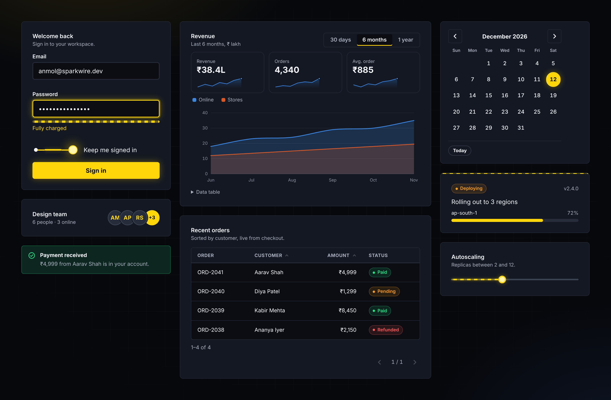
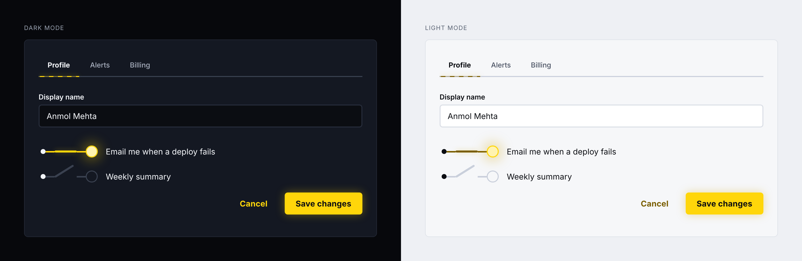
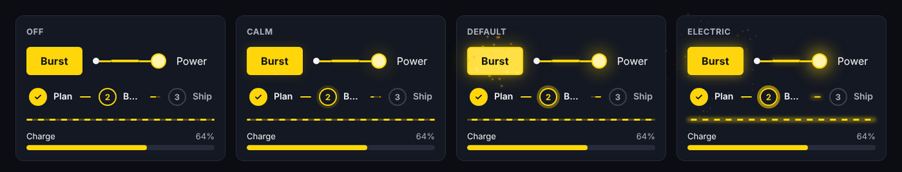
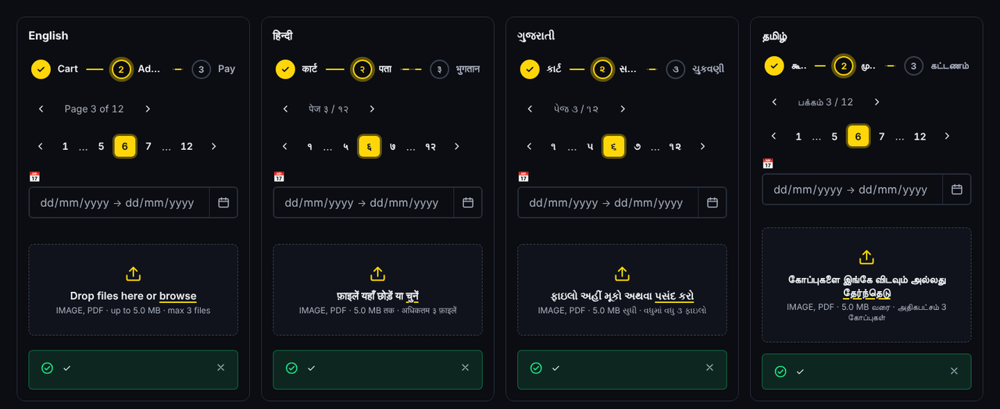

<div align="center">


# Sparkwire

**Accessible React components with a live wire.**

A complete, stable component library for React 18 and 19: forms, dates, data tables, charts and overlays,<br />
built on React Aria, styled with plain CSS variables, and translated into four languages.

[](https://www.npmjs.com/package/@sparkwire/core)
[](https://www.npmjs.com/package/@sparkwire/core)
[](https://github.com/phoenix-am/spark-ui/actions/workflows/ci.yml)
[](LICENSE)

[**Documentation**](https://phoenix-am.github.io/spark-ui/) ·
[Getting started](https://phoenix-am.github.io/spark-ui/docs/getting-started) ·
[Components](https://phoenix-am.github.io/spark-ui/components/button) ·
[Theme builder](https://phoenix-am.github.io/spark-ui/theme-builder) ·
[Changelog](packages/core/CHANGELOG.md)

<br />



</div>

<br />

## Features

- **Accessible by default.** Keyboard support, focus management and screen-reader labels come built in. The complex widgets (date pickers, comboboxes, menus, tables) are built on [React Aria](https://react-spectrum.adobe.com/react-aria/), and every documented example is checked with axe in CI.
- **45+ components.** Everything a product needs, from buttons and form fields to a full DataTable, charts, a command palette and ready-made page blocks.
- **Plain CSS, no runtime.** Every design token is a `--spark-*` CSS variable and every state is a `data-*` attribute. Nothing runs at render time, so it works in React Server Components, and a Tailwind preset is included.
- **Light, dark and system themes.** Switch with one prop or attribute, or build your own palette in the [theme builder](https://phoenix-am.github.io/spark-ui/theme-builder).
- **A look of its own, with a dial.** The Live Wire style adds sparks, glow and current to interactions. One setting turns it up for a launch page, down for an admin panel, or off.
- **Four languages built in.** Every built-in label comes in English, Hindi, Gujarati and Tamil, with native digits and locale-aware dates.
- **Use it your way.** Install the package, use only the headless hooks, or copy the source into your project with the CLI.
- **Stable API.** Semantic versioning since 1.0: breaking changes only in a new major version, with development warnings first.

## Installation

```bash
npm install @sparkwire/core
```

```bash
pnpm add @sparkwire/core      # or
yarn add @sparkwire/core
```

React 18 or 19 is required as a peer dependency.

## Quick start

Import the stylesheet once, then import components from their own paths:

```tsx
// app/layout.tsx (Next.js) or src/main.tsx (Vite)
import '@sparkwire/core/styles.css';
```

```tsx
import { Button } from '@sparkwire/core/button';
import { DatePicker } from '@sparkwire/core/date-picker';
import { Textfield } from '@sparkwire/core/textfield';

export default function CheckoutForm() {
  return (
    <form>
      <Textfield label="Full name" required />
      <DatePicker label="Delivery date" presets={['today', 'tomorrow', '+7d']} />
      <Button type="submit">Place order</Button>
    </form>
  );
}
```

Want to try it first? Open the starter app in your browser, no install needed:

[](https://stackblitz.com/github/phoenix-am/spark-ui/tree/master/examples/starter?file=src/App.tsx)

No provider is required. Each component is a separate entry point, so you only ship what you import, and every file is marked `"use client"` for the Next.js App Router.

## Components

| Category | Components |
| --- | --- |
| **Inputs** | Button, Textfield, Textarea, NumberField, Checkbox, Switch, RadioGroup, Slider, Dropdown, Combobox, ToggleGroup, FileUpload, Field |
| **Dates and time** | DatePicker, DateRangePicker, Calendar, RangeCalendar, TimePicker |
| **Navigation** | Tabs, Menu, CommandPalette, Sidebar, Drawer, Breadcrumbs, Pagination, Stepper |
| **Data display** | DataTable, LineChart, BarChart, DonutChart, Sparkline, Card, Avatar, Badge, Accordion |
| **Feedback** | Alert, Toast, Modal, Tooltip, Progress, Spinner, Skeleton |
| **Blocks** | Dashboard, sign-in and settings pages, ready to copy |
| **Build your own** | ButtonBase, InputBase, Popover, ListBox, Overlay, and headless hooks |

**DataTable** includes sorting, search, filters, pagination, row selection with bulk actions, virtual scrolling, resizable and pinned columns, expandable rows and inline editing, and switches to a card layout on narrow screens.

Every component, with live examples and its full prop reference, is on the [documentation site](https://phoenix-am.github.io/spark-ui/).

## Theming



Choose a mode with `ThemeProvider`, or set `data-spark-theme` on any element:

```tsx
import { ThemeProvider } from '@sparkwire/system';

<ThemeProvider mode="system" global>
  <App />
</ThemeProvider>
```

Change any token in plain CSS:

```css
:root {
  --spark-brand-fill: #3af2ff;
  --spark-brand-ink: #3af2ff;
  --spark-radius-medium: 12px;
  --spark-font: 'Inter', sans-serif;
}
```

Every token is also available as a Tailwind utility (`bg-spark-raised`, `text-spark-brand-ink`, `rounded-spark-md`) through `@sparkwire/core/tailwind.css`. See the [theming guide](https://phoenix-am.github.io/spark-ui/docs/theming) for the full token list.

## The energy dial



```tsx
<SparkProvider energy="calm">…</SparkProvider>      // dashboards and admin panels
<SparkProvider energy="electric">…</SparkProvider>  // launch pages and marketing
```

One setting scales every spark, glow and current at once. When the user's system asks for reduced motion, the energy is always `off`.

## Languages



```tsx
<SparkProvider locale="hi-IN">…</SparkProvider>
```

Button labels, screen-reader names, validation and upload messages, and date presets all follow the locale. Numbers and dates are formatted with `Intl`, other calendar systems are supported, and layouts work right to left. Change any wording, or add a language, with the `messages` prop.

## Ways to use it

**npm package.** Install `@sparkwire/core` and import components, as above.

**Copy the source.** Add a component and everything it depends on to your own project, then change anything you like:

```bash
npx sparkwire add date-picker
npx shadcn add @sparkwire/data-table   # or with the shadcn CLI
```

**Headless hooks.** Keep the behaviour and accessibility, and bring your own markup: `useSwitch`, `useCheckbox`, `useSlider`, `useDatePicker` and more.

**AI coding tools.** The [`@sparkwire/mcp`](https://www.npmjs.com/package/@sparkwire/mcp) server and [`llms.txt`](https://phoenix-am.github.io/spark-ui/llms.txt) give assistants every prop and example, so they write working code the first time.

## Compatibility

| | |
| --- | --- |
| **React** | 18 and 19 |
| **Frameworks** | Next.js App Router, Vite, and other React setups |
| **Server Components** | Supported. Components are client components; tokens and styles are plain CSS |
| **Browsers** | Current Chrome, Edge, Firefox and Safari, tested in CI with Chromium, Firefox and WebKit |
| **TypeScript** | Types included |

## Packages

| Package | Description |
| --- | --- |
| [`@sparkwire/core`](https://www.npmjs.com/package/@sparkwire/core) | Components, styles, Tailwind preset and headless hooks |
| [`@sparkwire/system`](https://www.npmjs.com/package/@sparkwire/system) | `ThemeProvider` for modes and token overrides |
| [`@sparkwire/styles`](https://www.npmjs.com/package/@sparkwire/styles) | Design tokens and `createTheme()` |
| [`@sparkwire/icons`](https://www.npmjs.com/package/@sparkwire/icons) | Icon set |
| [`@sparkwire/utils`](https://www.npmjs.com/package/@sparkwire/utils) | Shared helpers |
| [`sparkwire`](https://www.npmjs.com/package/sparkwire) | CLI that copies components into your project |
| [`@sparkwire/mcp`](https://www.npmjs.com/package/@sparkwire/mcp) | MCP server for AI coding tools |

All packages share one version number and are published with npm provenance.

## Versioning

Sparkwire follows [semantic versioning](https://semver.org). Since 1.0, the public API is stable: patch releases fix bugs, minor releases add features without breaking existing code, and only a major release removes or renames anything. Deprecated props keep working and log a development warning that names the replacement. Upgrading from 0.x? See [Versioning and upgrading](https://phoenix-am.github.io/spark-ui/docs/versioning).

## Documentation

- **[Documentation site](https://phoenix-am.github.io/spark-ui/):** live examples and the full prop reference for every component, in dark and light mode.
- **[Guide](docs/guide.md):** theming, the energy dial, languages and dates, forms, and each component in depth.
- **[Accessibility](docs/accessibility.md):** what is handled for you, what is tested, and known gaps.
- **[Translations](docs/translations.md):** every built-in label in all four languages. Corrections from native speakers are welcome.
- **[Changelog](packages/core/CHANGELOG.md):** what changed in each release.

## Contributing

Issues and pull requests are welcome.

```bash
git clone https://github.com/phoenix-am/spark-ui.git
cd spark-ui
npm ci --legacy-peer-deps
npm run docs     # documentation site at localhost:5173
npm test         # behaviour tests and axe checks on every example
npm run build
```

To add an example, put a React file in `site/src/demos/<component>/` and it appears on that component's page. Pull requests that change a package need a changeset: run `npx changeset`, choose patch, minor or major, and describe the change in one line.

## License

[MIT](LICENSE) © 2026 Anmol Mehta
