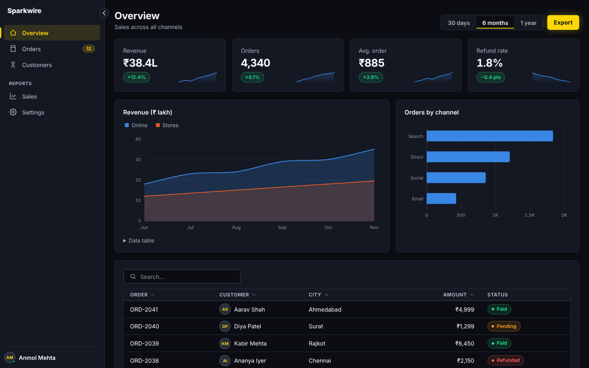

# @sparkwire/core

React components that carry current: accessible behaviour you can trust, a look nobody else has, and code you can own.



```bash
npm install @sparkwire/core
```

```tsx
import '@sparkwire/core/styles.css'; // once, e.g. in app/layout.tsx
import { Button } from '@sparkwire/core/button';
import { DatePicker } from '@sparkwire/core/date-picker';

<DatePicker label="Delivery date" presets={['today', 'tomorrow', '+7d']} />
<Button>Place order</Button>
```

- **40+ components:** inputs, date and time pickers, DataTable, charts, CommandPalette, Sidebar, Drawer, Stepper, FileUpload and more.
- **Restyle in plain CSS:** `--spark-*` variables, `data-*` states, no CSS-in-JS runtime, works in React Server Components.
- **Tailwind:** `@import "@sparkwire/core/tailwind.css"` (v4) or `require('@sparkwire/core/tailwind-preset')` (v3).
- **Energy dial:** `<SparkProvider energy="calm | default | electric | off">` scales all motion; reduced motion always means off.
- **Languages:** built-in text in English, Hindi, Gujarati and Tamil.
- **Make it yours:** a `render` prop, app-wide defaults and theme variants in `SparkProvider`, headless hooks in `@sparkwire/core/headless`.
- **Accessible:** built on React Aria, axe-checked in CI. React 18 and 19.

**[Docs and live examples](https://phoenix-am.github.io/spark-ui/)** · [GitHub](https://github.com/phoenix-am/spark-ui) · [Changelog](https://github.com/phoenix-am/spark-ui/blob/master/packages/core/CHANGELOG.md)

Part of [Sparkwire](https://github.com/phoenix-am/spark-ui). MIT licensed.
